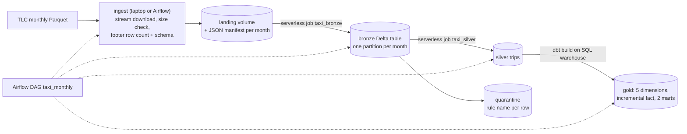

# NYC taxi lakehouse

A batch pipeline that loads New York City yellow-taxi trip records month by month into a Delta Lake lakehouse on Databricks, builds a tested star schema with dbt, and is orchestrated by Apache Airflow. A monthly schedule loads the month four months back, because TLC files appear up to 83 days after their month ends (`docs/evidence/a8/b1-publication-lag.txt`); backfills and manual runs with a `month` parameter load any month.

Tools: Python 3.12, PySpark on Databricks serverless, Delta Lake, Unity Catalog volumes, Databricks Asset Bundles, dbt (dbt-databricks), Apache Airflow 3.3.2 in Docker, SQL, GitHub Actions.

The source is the public [TLC Trip Record Data](https://www.nyc.gov/site/tlc/about/tlc-trip-record-data.page): one Parquet file per month, published typically two months late according to the TLC, with columns added over time.

The full project documentation, from source file to gold table, is in [docs/DOCUMENTATION.md](docs/DOCUMENTATION.md).

## Architecture



Each month moves through five steps, which are also the five Airflow tasks: ingest, bronze, silver, dbt build, reconciliation. Every row is accounted for: Parquet footer rows = bronze rows = silver rows + quarantined rows, and fact rows = silver rows, checked for every loaded month by the dbt test `dbt/tests/reconcile_months.sql`. A larger diagram is in [docs/architecture.md](docs/architecture.md) (render check of all diagrams: `docs/evidence/mermaid-render-2026-11-17.txt`), and the reasons behind each choice are in [docs/EXPLAIN.md](docs/EXPLAIN.md).

## Measured results

The ten checks the project was built against are listed in [docs/acceptance-checks.md](docs/acceptance-checks.md).

| What | Result | Evidence |
|---|---|---|
| Months loaded | 33, from 2024-01 to 2026-09 (2026-10 returned HTTP 403, not published yet) | `docs/evidence/a5-backfill-final.txt`, `docs/evidence/a1-all-months-footer-schemas.txt` |
| Rows | 123,471,721 in bronze, equal to the Parquet footer counts; 119,698,837 in silver and in the fact table; 3,772,884 quarantined | `docs/evidence/a5-backfill-final.txt` |
| Reconciliation | All 33 months: footer rows = bronze = silver + quarantine, and fact = silver; the dbt test takes its months from all five tables and fails on an empty manifest | `docs/evidence/a5-backfill-final.txt`, `docs/evidence/a8/dbt-fixes-fresh-build.txt` |
| Quarantined rows by rule | `negative_fare_or_total` 3,763,632; `dropoff_before_pickup` 3,820; `trip_distance_over_500mi` 3,767; `duration_over_24h` 863; `pickup_outside_file_month` 802. The two other rules, `missing_timestamp` and `negative_trip_distance`, matched no rows. Of the `negative_fare_or_total` rows, 57.8 % are payment type 0 (Flex Fare), 26.4 % dispute, 10.1 % cash, 5.6 % no charge, 0.2 % credit card | `docs/evidence/a5-backfill-final.txt`, `docs/evidence/a8/m7-negative-fare-rows.txt` |
| Schema changes handled | 3 source schemas; `cbd_congestion_fee` added from 2025-01, `request_source` from 2026-06, both merged into one bronze table | `docs/evidence/a1-all-months-footer-schemas.txt`, `docs/evidence/a5-backfill-final.txt` |
| dbt | 4 seeds, 9 models, 36 tests; `dbt build --vars "{month: '2026-07'}"` PASS=48, ERROR=0 (35 tests in the build, the reconciliation test after it) | `docs/evidence/a8/dbt-fixes-fresh-build.txt` |
| Cleaning rules | One CASE expression; 14 handmade rows in the SQL warehouse give the expected rule, including first match wins, a NULL fare passing to silver, and the 24 h and 500 mi edges; a deliberately wrong rule fails the test | `docs/evidence/a8/m1-rules-warehouse-test.txt` |
| Exact duplicate rows | 12 groups (24 rows) in 5 of 33 months; kept, and reported by a warn-level dbt test | `docs/evidence/a8/dbt-fixes-fresh-build.txt` |
| Idempotent reload | Reloading 2026-07 wrote a new Delta version of bronze, silver, quarantine and fact and left every row count and content checksum unchanged (bronze 3,530,109; silver and fact 3,515,235; quarantine 14,874) | `docs/evidence/a8/b1-scheduled-run-2026-07.txt` |
| Scheduled Airflow run | The scheduled run with logical date 1 Nov 2026, cleared and re-run on 17 Nov 2026 with no month given, loaded 2026-07; all five tasks succeeded | `docs/evidence/a8/b1-scheduled-run-2026-07.txt`, `docs/evidence/a8/b1-publication-lag.txt` |
| Airflow, one month from a clean start | 2025-02: five tasks succeeded in 6 min 53 s | `docs/evidence/a4-airflow-clean-start-2025-02.txt` |
| Airflow backfill | 30 months in three backfills, 0 failed runs, 21:11 to 22:49 IST on 16 Nov 2026 (98 minutes, about 3.3 minutes a month) | `docs/evidence/a5-backfill-final.txt` |
| Databricks job time | median 29.5 s (bronze) and 30 s (silver) per job, the wall-clock time of the ledgered `taxi.run_job` command (start request to SUCCESS, plus client start-up), over 36 runs of each; range 26 to 38 s (bronze) and 28 to 330 s (silver) | `docs/run-ledger.md` |
| Airflow memory | 624 MiB idle; peak 1,207 MiB on the 2025-02 run and 1,086 MiB during the backfill (limit then 1,280 MiB; now 1,536 MiB) | `docs/evidence/a4-airflow-idle-memory.txt`, `docs/evidence/a5-backfill-final.txt`, `docs/evidence/a5-memory-samples/` |
| Unit tests | 64 pytest tests (ingest, retries and timeouts, run ledger, schedule month, cleaning rules, configuration), plus the opt-in warehouse test above; `make ci` prints "64 passed, 1 skipped" | `docs/evidence/make-ci-2026-11-17.txt` |

## Repository layout

| Path | Contents |
|---|---|
| `src/taxi/` | ingest (download, validate, upload, manifest), landing storage, job runner, month choice for Airflow runs, configuration |
| `jobs/` | PySpark jobs for Databricks serverless: `bronze.py`, `silver.py` |
| `dbt/` | staging view, dimensions, incremental fact, marts, seeds, tests |
| `airflow/` | Dockerfile, `docker-compose.yml`, the DAG `dags/taxi_monthly.py` |
| `databricks.yml` | Asset Bundle that deploys the two serverless jobs |
| `scripts/` | run ledger and quota guard, secret scan, SQL helper, idempotency snapshot |
| `tests/` | pytest tests; `test_rules_warehouse.py` runs only with `TAXI_WAREHOUSE_TESTS=1` and credentials |
| `docs/` | design notes, architecture, run ledger, evidence files |

## How to run

Prerequisites: a Databricks workspace (Free Edition works) with a SQL warehouse, [uv](https://docs.astral.sh/uv/), the Databricks CLI, the `timeout` command (used by `scripts/ledger.sh` to limit every Databricks run), and Docker for Airflow.

1. Put the workspace address and a personal access token in `.secrets.env` in the folder that contains the repository (or point `TAXI_SECRETS_FILE` at another file); it is never inside the repository:
   ```
   DATABRICKS_HOST=https://<your-workspace>.cloud.databricks.com
   DATABRICKS_TOKEN=<token>
   ```
2. Set the catalog in `src/taxi/config.py` (`CATALOG`, or the `TAXI_CATALOG` variable), `databricks.yml` and `dbt/profiles.yml`. Copy `local.env.example` to `local.env` (gitignored) and set your SQL warehouse's HTTP path there; `make`, dbt and the Airflow container read it from that file. The quota guard is optional and off by default: to share a quota log with other projects, set its absolute path as `TAXI_QUOTA_LOG` in `local.env` (for `make`), and export it as `TAXI_QUOTA_LOG_FILE` in the shell before `docker compose up` (for Airflow), and `scripts/ledger.sh` refuses to start a Databricks run while that log's last `QUOTA-STOP` or `QUOTA-RESUME` line is a `QUOTA-STOP`. Create the landing volume once, in the SQL editor:
   ```sql
   CREATE SCHEMA IF NOT EXISTS analytics.taxi_landing;
   CREATE VOLUME IF NOT EXISTS analytics.taxi_landing.raw;
   ```
3. Install and check:
   ```bash
   uv sync
   make ci
   ```
4. Deploy the jobs and load one month end to end without Airflow:
   ```bash
   make deploy
   make run MONTH=2025-01
   ```
5. Or run it in Airflow: start the stack, then trigger `taxi_monthly` with `--conf '{"month": "2025-03"}'` and unpause it (a new DAG starts paused; unpausing also starts the latest scheduled run):
   ```bash
   docker compose -p taxi -f airflow/docker-compose.yml up -d
   docker compose -p taxi -f airflow/docker-compose.yml exec airflow airflow dags trigger taxi_monthly --conf '{"month": "2025-03"}'
   docker compose -p taxi -f airflow/docker-compose.yml exec airflow airflow dags unpause taxi_monthly
   ```
   A month range: `docker compose -p taxi -f airflow/docker-compose.yml exec airflow airflow backfill create --dag-id taxi_monthly --from-date 2024-01-01 --to-date 2024-11-01 --max-active-runs 1`. The Airflow UI is at http://127.0.0.1:8080. Every incremental `dbt build` needs `--vars "{month: 'YYYY-MM'}"`; `make run` and the DAG pass it.

Every Databricks job run, dbt build or test, ingest and deploy started from `make` or Airflow is logged to [docs/run-ledger.md](docs/run-ledger.md), with its duration. The first bundle deploy, a few one-off setup calls on 16 Nov 2026 (catalog listing, `bundle validate`) and the first `make ingest` of 2024-12 and 2025-01 (logged after the fact, with no duration) were not. The Airflow container mounts the repository read-write so that runs can append to the ledger.

## Scope and platform limits

- Built on Databricks Free Edition ([limitations](https://docs.databricks.com/aws/en/getting-started/free-edition-limitations)): serverless compute only, one 2X-Small SQL warehouse, and a compute quota whose size is not published; an account that exceeds it loses compute for the rest of the day. Authentication uses a personal access token from a local file.
- Files are downloaded on the laptop or in the Airflow container and uploaded to a volume, because Free Edition restricts outbound internet access from Databricks to a limited set of trusted domains. An S3 landing zone was planned as an optional upgrade and not built.
- Airflow runs as one container with parallelism 1, sized for an 8 GB laptop shared with another project. It is a local demonstration, not a highly available deployment. The Airflow UI has no login (it is bound to 127.0.0.1 only), and the container receives the Databricks token through its environment. A healthcheck marks the container unhealthy if the API server, scheduler or DAG processor stops, but nothing restarts them.
- The marts are rebuilt in full on every `dbt build`; only the fact table is incremental.
- The GitHub Actions workflow (`.github/workflows/ci.yml`) runs the same steps as `make ci`, which passes locally, and then the secret scan over every file. It runs on every push and pull request; its first run on GitHub, on 17 Nov 2026, passed (see the repository's Actions tab).
- The workspace's default catalog `workspace` does not exist in the account used here; all objects live in the `analytics` catalog under `taxi_*` schemas.

## Known limits

Found in an independent review on 16 Nov 2026 and not changed, because the fix would need a reload of all 33 months or a redesign beyond this project's scope.

- **A failure can leave one month partly written for a short time.** Silver and quarantine are two Delta commits, and so are the bronze trips and the manifest row. A failure between them leaves the month inconsistent until the task runs again. Every task replaces exactly one month, and Airflow retries a failed task twice after 2 minutes. On a first load the reconciliation test fails on such a month; on a reload the table that was not rewritten still holds the previous load, so the counts can agree until the task runs again.
- **A file republished by TLC is not picked up.** Ingest skips a month whose landed file has the size recorded in the manifest. Some files carry the same `Last-Modified` date as a later month's file, weeks later than usual (2025-01 and 2025-02 both 2025-04-23; 2025-12 to 2026-02 all 2026-03-25; `docs/evidence/a8/b1-publication-lag.txt`), which may mean a republication. The trip key (month plus row position) is stable only while the file is unchanged. Detecting this would mean storing the ETag or `Last-Modified` in the manifest and re-ingesting on change.
- **The `negative_fare_or_total` rule quarantines Flex Fare trips.** 57.8 % of the 3,763,632 rows it catches are payment type 0 (Flex Fare), and most of those have a positive total (`docs/evidence/a8/m7-negative-fare-rows.txt`), so many are probably ordinary trips with a different fare coding. They stay in quarantine; moving them would mean reloading silver for every month. The marts therefore report gross amounts (`gross_total_amount`, `avg_gross_total_amount`) over trips that passed every rule.
- **A very late file is never loaded by the schedule.** All 33 files were out before the 1st of their month+4, the closest with 7 days to spare (`docs/evidence/a8/b1-publication-lag.txt`). A file published more than about 89 days after its month is skipped by its scheduled run, and no later scheduled run returns to it; load it with a manual run that sets `month`, or a backfill.
- **Freshness.** The scheduled run loads the month four months back, so the newest month arrives later than TLC publishes it; a manual run with `month` or a backfill can load a newer month sooner.
- **Exact duplicates are kept.** 24 rows in 5 months are exact copies of another row (`docs/evidence/a8/dbt-fixes-fresh-build.txt`); the warn-level test reports them and nothing removes them.
- **An old month that returns 403 or 404 fails the run.** A month more than six months old is expected to exist; a newer one is treated as not yet published and skipped.

## How this project was built

I built this project with AI assistance (Claude Code). I set the goal and the constraints, approved the design and directed the work. AI agents wrote the code, which then went through an independent code review; its findings are fixed or listed under Known limits. Each measured result in this README names its source, usually a file in `docs/evidence/`.

## License

The code is released under the MIT License; see [LICENSE](LICENSE). The file `dbt/seeds/taxi_zone_lookup.csv` is published by the New York City Taxi and Limousine Commission and is included unchanged.
