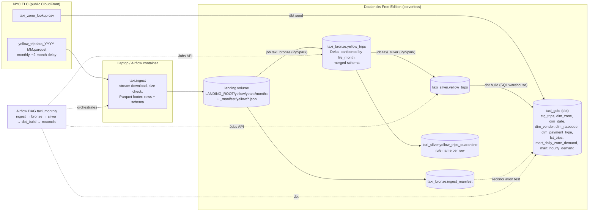
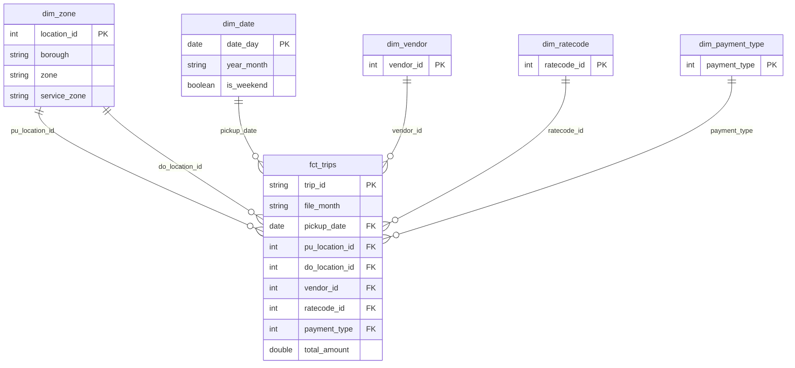

# NYC taxi lakehouse: project documentation

This document follows one month of New York City yellow-taxi trips from the publisher's file to the gold tables. It describes the code at the current commit. Measured results live in the [README](../README.md#measured-results) and in `docs/evidence/`; the reasoning behind each design choice is in [EXPLAIN.md](EXPLAIN.md).

## 1. Overview and problem statement

**Business problem.** The NYC Taxi and Limousine Commission (TLC) publishes every yellow-taxi trip as one large file per month. Analysts who want demand by zone, day or hour have to download each file, cope with columns that appear over time, separate bad records from good ones, and repeat this every month without double-counting a month they already loaded.

**Goal.** A batch pipeline that loads any month into a Delta Lake lakehouse on Databricks, accounts for every source row, builds a tested star schema with dbt, and runs on a monthly schedule in Apache Airflow. Reloading a month must leave the tables as they were.

**In scope.** Yellow-taxi trip records from 2024-01 onwards, the TLC taxi zone lookup and the code lists from the TLC data dictionary; landing, bronze, silver and gold layers; data quality rules with a quarantine table; row reconciliation for every month; Airflow scheduling, backfill and retries; a run ledger.

**Out of scope.** Green taxi, for-hire vehicle and high-volume for-hire trip records; streaming or intraday loads; dashboards; a landing zone in S3 (planned as an option, not built); a highly available Airflow deployment. The README lists the platform limits that shaped these choices ([Scope and platform limits](../README.md#scope-and-platform-limits)).

## 2. Data sources

| Source | What it is | Format and cadence |
|---|---|---|
| Yellow taxi trip records | One file per month, `https://d37ci6vzurychx.cloudfront.net/trip-data/yellow_tripdata_YYYY-MM.parquet` (`src/taxi/config.py`, `src/taxi/ingest.py`) | Parquet, monthly |
| Taxi zone lookup | `https://d37ci6vzurychx.cloudfront.net/misc/taxi_zone_lookup.csv`, stored unchanged as the dbt seed `dbt/seeds/taxi_zone_lookup.csv` | CSV, one row per zone |
| Code lists | Vendor, rate code and payment type names copied from the TLC "Data Dictionary - Yellow Taxi Trip Records" of 18 March 2025 into `dbt/seeds/` (`dbt/seeds/_seeds.yml`) | CSV seeds |

**Publication lag.** The TLC download page says trip data is published monthly, typically with a two-month delay to allow for vendor submissions. Measured from the HTTP `Last-Modified` header, the 33 files from 2024-01 to 2026-09 appeared 18 to 83 days after their month ended (`docs/evidence/a8/b1-publication-lag.txt`). A `Last-Modified` date may belong to a republication, so these delays are upper bounds.

**Size.** The 33 monthly files are 50.0 MB to 77.8 MB each, 2.10 GB in total, by the byte counts in `docs/evidence/a1-all-months-footer-schemas.txt`. The zone lookup is 12,331 bytes with 265 zones (`dbt/seeds/taxi_zone_lookup.csv`). Row counts are in the [README](../README.md#measured-results).

**Schema over time.** Three schemas occur. `cbd_congestion_fee` appears from 2025-01 and `request_source` from 2026-06; no column is renamed or retyped (`docs/evidence/a1-all-months-footer-schemas.txt`).

**Terms.** The [TLC trip record page](https://www.nyc.gov/site/tlc/about/tlc-trip-record-data.page) states no licence for the files. It says the records were collected and provided to the TLC by authorized technology providers, that the TLC did not create them, and that it makes no representations as to their accuracy. The site's general terms are linked from its footer as "Terms of use" (page read on 17 Nov 2026).

## 3. Architecture

This is the diagram from [architecture.md](architecture.md); the README carries a shorter version. The render check of all three diagrams, at their current labels, is in `docs/evidence/mermaid-render-2026-11-17.txt`.



**Flow for one month.** `taxi.ingest` runs outside Databricks, on the laptop or in the Airflow container, because Databricks Free Edition restricts outbound internet access to a limited set of trusted domains ([Free Edition limitations](https://docs.databricks.com/aws/en/getting-started/free-edition-limitations)). It streams the Parquet file to local disk, checks its size, reads the row count and schema from the file footer, uploads the file to the landing volume (the Unity Catalog volume `taxi_landing.raw`) and writes a JSON manifest record to `LANDING_ROOT/_manifest/yellow/YYYY-MM.json`. The serverless job `taxi_bronze` loads the file into a Delta table and the manifest record into `taxi_bronze.ingest_manifest`. The serverless job `taxi_silver` types and renames the columns and sends each row either to silver or to quarantine. dbt, running against the SQL warehouse, builds the staging view, the dimensions, the incremental fact table and two marts in `taxi_gold`, and the singular test `reconcile_months` checks the row counts of every layer. Airflow runs these five steps in order; `make run MONTH=YYYY-MM` runs the same steps without Airflow.

## 4. Technology stack

| Tool | Version | Source of the version | Job in this project |
|---|---|---|---|
| Python | 3.12 | `.python-version` and the Airflow image tag; `requires-python = ">=3.12"` | Ingest, job runner, tests |
| uv | 0.13.1 | `.github/workflows/ci.yml`, build backend `uv_build>=0.13.1,<0.14.0` | Environment, lock file, build |
| Databricks serverless compute | environment version 5 | `databricks.yml` | Runs the PySpark jobs `taxi_bronze` and `taxi_silver` |
| Delta Lake, Unity Catalog | managed by Databricks | none | Tables, landing volume |
| Databricks Asset Bundles (Databricks CLI) | CLI not pinned; layout of the v1.26.0 template | `databricks.yml` | Deploys the two jobs (`make deploy`) |
| databricks-sdk | 0.117.0 | `uv.lock`, `airflow/requirements.txt` | Files API uploads, Jobs API runs, SQL statements |
| databricks-sql-connector | 4.4.0 | `uv.lock`, `airflow/requirements.txt` | Used by dbt-databricks |
| dbt-core | 1.12.6 | `uv.lock`, `airflow/requirements.txt` | Gold models and tests |
| dbt-databricks | 1.13.0 | `uv.lock`, `airflow/requirements.txt` | dbt adapter for the SQL warehouse |
| pyarrow | 26.0.1 | `uv.lock`, `airflow/requirements.txt` | Reads the Parquet footer |
| requests | 2.34.2 | `uv.lock`, `airflow/requirements.txt` | Streams the source download |
| Apache Airflow | 3.3.2 | image tag `apache/airflow:3.3.2-python3.12` in `airflow/Dockerfile` | Schedule, backfill, retries; project packages in a separate virtualenv, `/opt/taxi-venv`, installed with `--require-hashes` |
| PostgreSQL | 16.14 | image tag `postgres:16.14-alpine` in `airflow/docker-compose.yml` | Airflow metadata database |
| pytest | 9.2.0 | `uv.lock` | Unit tests |
| ruff | 0.17.5 | `uv.lock` | Lint |
| GitHub Actions | pinned by commit SHA; the workflow comment names them checkout v7.0.1 and setup-uv v10.3.3 | `.github/workflows/ci.yml` | Runs `make ci` and the secret scan |

## 5. Data model

All tables live in one catalog, `analytics` by default (`TAXI_CATALOG` in `src/taxi/config.py` and `dbt/profiles.yml`, the `catalog` variable in `databricks.yml`).

| Layer | Object | Grain | Key | Partitioning | Written by |
|---|---|---|---|---|---|
| Landing | volume `taxi_landing.raw`: `yellow/year=YYYY/month=MM/yellow_tripdata_YYYY-MM.parquet` and `_manifest/yellow/YYYY-MM.json` | one file and one manifest record per month | month | folder per year and month | `src/taxi/ingest.py` |
| Bronze | `taxi_bronze.yellow_trips` | one row per source row | `file_month`, `_source_row` | `file_month` | `jobs/bronze.py` |
| Bronze | `taxi_bronze.ingest_manifest` | one row per landed file | `file_month` | none | `jobs/bronze.py` |
| Silver | `taxi_silver.yellow_trips` | one row per trip that passed every rule | `trip_id` | `file_month` | `jobs/silver.py` |
| Silver | `taxi_silver.yellow_trips_quarantine` | one row per trip that broke a rule | `trip_id` | `file_month` | `jobs/silver.py` |
| Gold | `taxi_gold.stg_trips` (view) | one row per silver trip | `trip_id` | none | dbt |
| Gold | `taxi_gold.fct_trips` (incremental table) | one row per silver trip | `trip_id` | `file_month` | dbt |
| Gold | `taxi_gold.dim_zone`, `dim_vendor`, `dim_ratecode`, `dim_payment_type` | one row per code | `location_id`, `vendor_id`, `ratecode_id`, `payment_type` | none | dbt seeds and models |
| Gold | `taxi_gold.dim_date` | one row per day from 2024-01-01 to the end of next year | `date_day` | none | dbt |
| Gold | `taxi_gold.mart_daily_zone_demand` | one row per pickup date and pickup zone | `demand_key` | none | dbt |
| Gold | `taxi_gold.mart_hourly_demand` | one row per file month and pickup hour | `demand_key` | none | dbt |

Bronze keeps every source column as published and adds `_source_file`, `_source_row` (the row's position in the file, from `_metadata.row_index`), `_load_ts` and `file_month`. Silver keeps the 21 columns listed in `COLUMNS` in `jobs/silver.py`, renamed to snake case and cast, plus `trip_id`, `file_month`, `_source_file`, `_source_row` and `_load_ts`. The quarantine table has the same columns plus `rule`. The trip key is `trip_id = file_month || '-' || _source_row`, because the source has no trip identifier.

**Gold star schema.** The fact table joins to each dimension on one column. `dim_zone` plays two roles, pickup and drop-off zone. Every join is enforced by a dbt `relationships` test in `dbt/models/schema.yml`. The two marts aggregate `fct_trips`; `mart_daily_zone_demand` also joins `dim_zone` for the borough and zone names.



### Column dictionary

Column names and types come from `DESCRIBE TABLE` on the gold tables in the warehouse on 17 Nov 2026 (`docs/evidence/describe-tables-2026-11-17.txt`). Descriptions come from `dbt/models/schema.yml` where it has one, otherwise from the model's SQL.

`fct_trips`

| Column | Type | Description |
|---|---|---|
| `trip_id` | string | File month plus the row's position in the source file; stable while the source file is unchanged. |
| `file_month` | string | Month of the source file (YYYY-MM). |
| `pickup_date` | date | Date the meter was engaged. |
| `pickup_hour` | int | Hour of pickup, 0 to 23 (`hour(pickup_ts)` in `stg_trips`). |
| `pu_location_id` | int | Pickup zone. |
| `do_location_id` | int | Drop-off zone. |
| `vendor_id` | int | TPEP provider code. |
| `ratecode_id` | int | Final rate code in effect at the end of the trip; a missing code is set to 99 (Null/unknown) in `stg_trips`. |
| `payment_type` | int | How the passenger paid (code). |
| `passenger_count` | int | Passenger count as published (source `passenger_count`). |
| `trip_distance` | double | Trip distance as published (source `trip_distance`). |
| `duration_min` | decimal(27,6) | Drop-off time minus pickup time, in minutes (computed in `stg_trips`). |
| `fare_amount` | double | Source `fare_amount`. |
| `tip_amount` | double | Source `tip_amount`. |
| `tolls_amount` | double | Source `tolls_amount`. |
| `congestion_surcharge` | double | Source `congestion_surcharge`. |
| `airport_fee` | double | Source `Airport_fee`. |
| `cbd_congestion_fee` | double | Source `cbd_congestion_fee`; NULL for months before the column existed. |
| `total_amount` | double | Source `total_amount`. |

Dimensions

| Table | Column | Type | Description |
|---|---|---|---|
| `dim_zone` | `location_id` | int | TLC taxi zone id. |
| `dim_zone` | `borough` | string | Source `Borough`. |
| `dim_zone` | `zone` | string | Source `Zone`. |
| `dim_zone` | `service_zone` | string | Source `service_zone`. |
| `dim_date` | `date_day` | date | Calendar day. |
| `dim_date` | `year` | int | `year(date_day)`. |
| `dim_date` | `month` | int | `month(date_day)`. |
| `dim_date` | `year_month` | string | `yyyy-MM`; matches `file_month`. |
| `dim_date` | `day_of_week` | int | `dayofweek(date_day)`: 1 = Sunday, 7 = Saturday. |
| `dim_date` | `day_name` | string | Full day name (`EEEE`). |
| `dim_date` | `is_weekend` | boolean | True on Saturday and Sunday. |
| `dim_vendor` | `vendor_id` | int | TPEP provider code. |
| `dim_vendor` | `vendor_name` | string | Provider name from the TLC data dictionary (seed `taxi_vendor`). |
| `dim_ratecode` | `ratecode_id` | int | Final rate code in effect at the end of the trip. |
| `dim_ratecode` | `ratecode_name` | string | Rate code name from the TLC data dictionary (seed `taxi_ratecode`). |
| `dim_payment_type` | `payment_type` | int | How the passenger paid (code). |
| `dim_payment_type` | `payment_type_name` | string | Payment type name from the TLC data dictionary (seed `taxi_payment_type`). |

Marts

| Table | Column | Type | Description |
|---|---|---|---|
| `mart_daily_zone_demand` | `demand_key` | string | Grain key of the mart row. |
| `mart_daily_zone_demand` | `pickup_date` | date | Pickup date. |
| `mart_daily_zone_demand` | `pu_location_id` | int | Pickup zone id. |
| `mart_daily_zone_demand` | `borough` | string | From `dim_zone`. |
| `mart_daily_zone_demand` | `zone` | string | From `dim_zone`. |
| `mart_daily_zone_demand` | `trips` | bigint | `count(*)` of fact rows. |
| `mart_daily_zone_demand` | `gross_total_amount` | double | `sum(total_amount)`, rounded to 2 decimals. |
| `mart_daily_zone_demand` | `avg_trip_distance` | double | `avg(trip_distance)`, rounded to 3 decimals. |
| `mart_hourly_demand` | `demand_key` | string | Grain key of the mart row. |
| `mart_hourly_demand` | `file_month` | string | Month of the source file. |
| `mart_hourly_demand` | `pickup_hour` | int | Hour of pickup, 0 to 23. |
| `mart_hourly_demand` | `trips` | bigint | `count(*)` of fact rows. |
| `mart_hourly_demand` | `avg_gross_total_amount` | double | `avg(total_amount)`, rounded to 2 decimals. |
| `mart_hourly_demand` | `avg_duration_min` | decimal(24,2) | `avg(duration_min)`, rounded to 2 decimals. |

## 6. Pipeline design, stage by stage

Every stage works on one month, `YYYY-MM`. Bronze, silver and the fact table replace exactly that month, so running a stage twice leaves the same rows and content as running it once; only the load time (`_load_ts`, the manifest's `uploaded_at`) and the Delta table version change.

### Ingest (`src/taxi/ingest.py`)

- **Input.** The month's Parquet file from the TLC address above. `python -m taxi.ingest YYYY-MM [--to YYYY-MM] [--force]`.
- **Output.** The file at `LANDING_ROOT/yellow/year=YYYY/month=MM/` and a manifest record at `LANDING_ROOT/_manifest/yellow/YYYY-MM.json` with `month`, `file`, `landing_path`, `bytes`, `rows`, `schema_hash`, `schema` and `uploaded_at`. `LANDING_ROOT` defaults to `/Volumes/analytics/taxi_landing/raw` and can be set with `TAXI_LANDING_ROOT`.
- **Incremental rule.** A month is skipped when its manifest exists and the landed file has the size the manifest records; `--force` loads it again.
- **Why a rerun is safe.** The download goes to a `.part` file that is renamed only after the byte count matches `Content-Length`, so a cut-off download is never used. The upload and the manifest overwrite the same paths.
- **Failures.** A download has a 10 s connect and 120 s read timeout and three attempts; connection errors, timeouts, broken chunked transfers, HTTP 5xx and size mismatches are retried. Uploads and manifest writes get three attempts. HTTP 403 or 404 means "not published yet" for a month at most six months old; for an older month it is a failure. A month whose download fails (after the retries above, for the errors they cover), or that is missing although older than six months, is recorded as failed, and ingest goes on to the next month of a `--to` range. An upload or manifest write that still fails after three attempts is recorded the same way when the error is a `requests` exception; any other error there, or an unreadable Parquet footer, stops the process with a traceback, and the later months are not attempted. The process exits 1 if any month failed or it stopped with a traceback, 99 if no month was published (Airflow's skip code), and 0 otherwise.
- **Schema change.** Ingest does not check the schema. It records the footer schema and a hash of it in the manifest.

### Bronze (`jobs/bronze.py`, job `taxi_bronze`)

- **Input.** The landed file and its manifest record. Arguments `--catalog`, `--landing-root`, `--month`; the month must match `YYYY-MM` because it goes into SQL text and a path.
- **Output.** `taxi_bronze.yellow_trips` and `taxi_bronze.ingest_manifest`.
- **Incremental rule.** Both writes use Delta `replaceWhere` on `file_month = 'YYYY-MM'`.
- **Why a rerun is safe.** `replaceWhere` overwrites only that month, and `_source_row` is the same on every load of an unchanged file. The job fails if the bronze row count for the month differs from the footer row count in the manifest.
- **Schema change.** `mergeSchema` adds a new source column to the table; rows of older months read it as `NULL`. Columns are never dropped.

### Silver (`jobs/silver.py`, job `taxi_silver`)

- **Input.** One month of `taxi_bronze.yellow_trips`.
- **Output.** `taxi_silver.yellow_trips` and `taxi_silver.yellow_trips_quarantine`.
- **Incremental rule.** Both tables are written with `replaceWhere` on the month.
- **Why a rerun is safe.** Both writes replace exactly the month. The job fails if bronze rows differ from silver rows plus quarantined rows.
- **Schema change.** Silver selects the columns listed in `COLUMNS`. A listed column that is missing in bronze becomes a typed `NULL`; a new source column stays in bronze until it is added to `COLUMNS`. `mergeSchema` is set on both writes.

### Gold (`dbt/`)

- **Input.** `taxi_silver.yellow_trips` (sources in `dbt/models/staging/_sources.yml`) and four seeds.
- **Output.** `stg_trips` (view), five dimensions and two marts (tables), `fct_trips` (incremental table), all in `taxi_gold`.
- **Incremental rule.** `fct_trips` uses `incremental_strategy='replace_where'` with the predicate `file_month = '<month>'`. An incremental run without `--vars "{month: 'YYYY-MM'}"` stops with a compile error; the first build of an empty table loads every month in silver. Dimensions and marts are rebuilt in full on every build.
- **Why a rerun is safe.** The fact replaces one month; the other models are full rebuilds.
- **Schema change.** `fct_trips` has `on_schema_change='append_new_columns'`. A new column reaches gold only after it is added to `stg_trips` and `fct_trips`.
- **Transformations.** `stg_trips` sets a missing rate code to 99 ("Null/unknown" in the TLC dictionary) and derives `pickup_date`, `pickup_hour` and `duration_min`. `dim_date` generates its calendar with `sequence()`, from 2024-01-01 to the end of the year after the current one.

## 7. Data quality and testing

### Cleaning rules

`RULES` in `jobs/silver.py` is the only definition. `rule_case_sql()` turns it into one SQL `CASE` expression, so the first rule that is true names the row, in this order:

| Order | Rule | Condition |
|---|---|---|
| 1 | `missing_timestamp` | `pickup_ts IS NULL OR dropoff_ts IS NULL` |
| 2 | `pickup_outside_file_month` | `date_format(pickup_ts, 'yyyy-MM') <> file_month` |
| 3 | `dropoff_before_pickup` | `dropoff_ts < pickup_ts` |
| 4 | `duration_over_24h` | `dropoff_ts > pickup_ts + INTERVAL 24 HOURS` |
| 5 | `negative_trip_distance` | `trip_distance < 0` |
| 6 | `trip_distance_over_500mi` | `trip_distance > 500` |
| 7 | `negative_fare_or_total` | `fare_amount < 0 OR total_amount < 0` |

A condition that evaluates to `NULL`, such as `fare_amount < 0` with a missing fare, is not true, so evaluation moves on to the next rule; a row that no rule matches goes to silver. A row that matches a rule goes to `taxi_silver.yellow_trips_quarantine` with the rule's name in the column `rule`. No row is deleted, and the rows per rule are one `GROUP BY rule` away.

### Reconciliation

`dbt/tests/reconcile_months.sql` returns one row for every month that breaks the chain: footer rows in the manifest = bronze rows = silver rows + quarantined rows, and fact rows = silver rows. It takes its months from all five tables. A month missing from the manifest, bronze, silver or the fact is reported; a month with no quarantined rows counts as zero quarantined rows. The test also fails when the manifest is empty. Because every bronze row goes to exactly one of silver or quarantine, this test catches lost or partial writes; the rule tests below catch wrong rules.

### dbt tests

`dbt/models/schema.yml` declares `unique` and `not_null` on the key of every model, `not_null` and `relationships` tests from `fct_trips` to each dimension, and `accepted_values` on `vendor_id`, `ratecode_id` and `payment_type`. Two singular tests sit in `dbt/tests/`: `reconcile_months` and `duplicate_source_rows`, which counts the groups of exact duplicate source rows per month at `warn` severity, because the row-position key would let duplicates pass the unique tests. The README states the test count with its evidence.

### Unit tests

| File | What it covers |
|---|---|
| `tests/test_ingest.py` | Month parsing and ranges, landing path, 403 and size mismatch, file and manifest written, skip of a loaded month, `--force`, exit codes |
| `tests/test_timeouts.py` | Download and upload retries, timeouts, SDK client limits, cancelled job wait, 403 handling by month age |
| `tests/test_schedule.py` | Month choice for each kind of Airflow run |
| `tests/test_rules.py` | Rule order and the generated `CASE` expression without Spark, rule columns present in silver, month validation in both jobs, bronze path equal to the ingest layout |
| `tests/test_rules_warehouse.py` | The rule expression on handmade rows in the SQL warehouse; runs only with `TAXI_WAREHOUSE_TESTS=1` |
| `tests/test_ledger.py` | Quota refusal, opt-in guard, wall-clock limit, result column |
| `tests/test_config.py` | Workspace host cleanup, warehouse id from the environment |

### How to run them

```bash
make ci                                   # ruff, pytest, offline dbt parse
TAXI_WAREHOUSE_TESTS=1 uv run pytest tests/test_rules_warehouse.py   # needs credentials
make run MONTH=2025-01                    # includes dbt build and the reconciliation test
```

## 8. Orchestration and operations

### The DAG

`airflow/dags/taxi_monthly.py` defines `taxi_monthly`: schedule `@monthly`, start date 2024-01-01, `catchup=False`, `max_active_runs=1`. Its five `BashOperator` tasks run in a line: `ingest >> bronze >> silver >> dbt_build >> reconcile`. `bronze` and `silver` call `python -m taxi.run_job`, which starts the bundle-deployed job through the Jobs API and waits for it; `dbt_build` runs `dbt build` without the reconciliation test, and `reconcile` runs only that test. Every task runs through `scripts/ledger.sh`.

### Which month a run loads

`taxi.schedule.target_month` (`src/taxi/schedule.py`) decides:

| Kind of run | Month loaded |
|---|---|
| Any run with the `month` parameter | That month (must match `YYYY-MM`) |
| Backfill run | The month of its logical date |
| Scheduled run, or manual run without `month` | Four months before its date (`LAG_MONTHS = 4`) |

Four months back leaves room for the measured publication lag. If the month is still not published, `ingest` exits 99, Airflow marks the task skipped, and the downstream tasks are skipped.

### Retries and time limits

| Limit | Value | Where |
|---|---|---|
| Task retries | 2, after 2 minutes | DAG `default_args` |
| Task time limit | 25 minutes | `execution_timeout` |
| Run time limit | 60 minutes | `dagrun_timeout` |
| Ledger wall-clock limit | 1,440 s in the Airflow container, 1,800 s by default | `LEDGER_LIMIT_S`, `scripts/ledger.sh` |
| Wait for a Databricks job run | 20 minutes, then the run is cancelled | `RUN_LIMIT` in `src/taxi/run_job.py` |
| Databricks SDK calls | 120 s per request, retries stop after 300 s | `src/taxi/config.py` |

### Backfill and recovery

A month range is a backfill, one run at a time:

```bash
docker compose -p taxi -f airflow/docker-compose.yml exec airflow airflow backfill create --dag-id taxi_monthly --from-date 2024-01-01 --to-date 2024-11-01 --max-active-runs 1
```

To recover a failed month, trigger the DAG again with that month (`--conf '{"month": "YYYY-MM"}'`) or run `make run MONTH=YYYY-MM`. Each step replaces the month, so nothing needs cleaning up first. On a first load, a month left half written (for example silver written and quarantine not) fails `reconcile_months` until the rerun. On a reload, the table that was not rewritten still holds the previous load of that month, so the counts can still agree; the rerun replaces both tables.

### Run ledger and quota guard

`scripts/ledger.sh` wraps every Databricks job run, dbt build or test, ingest and deploy started from `make` or Airflow. It applies the wall-clock limit (TERM, then KILL 30 s later) and appends a row to [run-ledger.md](run-ledger.md) with the start time, what ran, the data size, the duration and the result (`OK`, `SKIP`, `TIMEOUT` or `FAIL`). The quota guard is optional and off by default. When `TAXI_QUOTA_LOG` names a file, the ledger refuses to start (exit 75) while that file's last `QUOTA-STOP` or `QUOTA-RESUME` line is a `QUOTA-STOP`. In the Airflow container the guard is on only when `TAXI_QUOTA_LOG_FILE` is exported in the shell before `docker compose up`.

## 9. Setup and how to run

The README section [How to run](../README.md#how-to-run) has the full commands and file contents. In short:

1. Prerequisites: a Databricks workspace (Free Edition works) with a SQL warehouse, uv, the Databricks CLI, the `timeout` command and Docker.
2. Put `DATABRICKS_HOST` and `DATABRICKS_TOKEN` in `.secrets.env` in the folder that contains the repository (or point `TAXI_SECRETS_FILE` at another file).
3. Copy `local.env.example` to `local.env` and set `TAXI_WAREHOUSE_HTTP_PATH`. To use a catalog other than `analytics`, set it in `src/taxi/config.py` (or `TAXI_CATALOG`), `databricks.yml` and `dbt/profiles.yml`. Optionally set `TAXI_QUOTA_LOG` in `local.env`, and export `TAXI_QUOTA_LOG_FILE` in the shell before `docker compose up`, to turn on the quota guard.
4. Create the landing volume once: `CREATE SCHEMA IF NOT EXISTS analytics.taxi_landing;` and `CREATE VOLUME IF NOT EXISTS analytics.taxi_landing.raw;`.
5. Install and check: `uv sync`, then `make ci`.
6. Deploy the jobs and load one month without Airflow: `make deploy`, then `make run MONTH=2025-01`.
7. Or use Airflow: `docker compose -p taxi -f airflow/docker-compose.yml up -d`, then trigger `taxi_monthly` with `--conf '{"month": "2025-03"}'` and unpause it (a new DAG starts paused; unpausing also starts the latest scheduled run).

The Makefile targets are:

| Target | What it does |
|---|---|
| `make lint` | `ruff check .` |
| `make test` | `pytest -q` |
| `make ci` | `lint`, `test`, then offline `dbt parse` |
| `make scan` | Secret scan of the staged diff |
| `make deploy` | `databricks bundle deploy` of the two jobs |
| `make ingest MONTH=YYYY-MM` | Download, check and upload one month |
| `make run MONTH=YYYY-MM` | Ingest, bronze, silver, `dbt build` and the reconciliation test, as the DAG does |

## 10. Results

The headline results, with the same numbers and evidence files as the README section [Measured results](../README.md#measured-results), which has the full table:

- 33 months loaded, from 2024-01 to 2026-09 (`docs/evidence/a5-backfill-final.txt`, `docs/evidence/a1-all-months-footer-schemas.txt`).
- 123,471,721 rows in bronze, equal to the Parquet footer counts; 119,698,837 in silver and in the fact table; 3,772,884 quarantined; all 33 months reconcile (`docs/evidence/a5-backfill-final.txt`).
- dbt: 4 seeds, 9 models, 36 tests; `dbt build --vars "{month: '2026-07'}"` PASS=48, ERROR=0 (`docs/evidence/a8/dbt-fixes-fresh-build.txt`).
- Reloading 2026-07 left every row count and content checksum unchanged (bronze 3,530,109; silver and fact 3,515,235; quarantine 14,874) (`docs/evidence/a8/b1-scheduled-run-2026-07.txt`).
- Airflow: one month from a clean start in 6 min 53 s (`docs/evidence/a4-airflow-clean-start-2025-02.txt`); 30 months backfilled in 98 minutes with 0 failed runs (`docs/evidence/a5-backfill-final.txt`).
- Unit tests: `make ci` prints "64 passed, 1 skipped" (`docs/evidence/make-ci-2026-11-17.txt`).

The acceptance checks are in [acceptance-checks.md](acceptance-checks.md).

Row counts and reconciliation come from SQL queries on the warehouse that compare the manifest, bronze, silver, quarantine and fact per month. Idempotency is measured by `scripts/idempotency_snapshot.py`, which records the row count, an `xxhash64` content checksum over every column except `_load_ts`, the table's latest Delta version and the latest `_load_ts` for one month in bronze, silver, quarantine and `fct_trips`, before and after a reload. Durations come from the run ledger, which times each wrapped command from start to end. Airflow run times come from the task start and end times of the run. Memory figures are `docker stats` samples taken while the stack was idle and during runs. Publication lag comes from the HTTP `Last-Modified` header of each monthly file. The cleaning rules are tested on handmade rows in the SQL warehouse, with a deliberately wrong rule as a control.

## 11. Design decisions

| Decision | Reason | Alternative rejected |
|---|---|---|
| Download and upload outside Databricks | Free Edition restricts outbound internet access to a limited set of trusted domains | Downloading inside a Databricks job |
| Row count from the Parquet footer | The footer holds the count; no data pages are read | Counting with pandas |
| Manifest in the landing volume | Ingest (on the laptop or in Airflow) and the bronze job both read it; the bronze job loads it into `taxi_bronze.ingest_manifest` for the reconciliation test | A manifest file on the laptop |
| `replaceWhere` per month in bronze and silver | A reload replaces exactly one month | `MERGE` on a business key (the source has none); append-only loads |
| Trip key from month and row position | Unique by construction within an unchanged file | A hash of all columns |
| Quarantine table with the first rule broken | Every row is kept and the counts add up | Dropping bad rows; tagging every rule a row breaks |
| dbt for gold, incremental fact by month | Tests, lineage and plain SQL; a monthly load touches one month | Gold in PySpark; views for the marts |
| One Airflow container with three processes, parallelism 1 | Fits the memory budget on an 8 GB laptop | The official Celery stack; `airflow standalone` |
| Project dependencies in a separate virtualenv in the image | No conflict with Airflow's pinned packages | Installing dbt into Airflow's environment |
| Scheduled run loads the month four months back | Every measured file was out by then | Two or three months back |
| Run ledger as a Markdown file | Keeps working when Databricks is the thing that failed | A database table |

The full reasoning, with what was measured and what would change at ten times the data, is in [EXPLAIN.md](EXPLAIN.md).

## 12. Limitations and future work

The README lists the [scope and platform limits](../README.md#scope-and-platform-limits) and the [known limits](../README.md#known-limits) found in review. In a production setting I would take these steps, in this order:

1. **Make each month's silver write atomic.** Silver and quarantine are two Delta commits today. One silver table with a nullable `rule` column and two views over it would make the split a single `replaceWhere` commit.
2. **Detect republished source files.** Store the `ETag` or `Last-Modified` of each file in the manifest and re-ingest a month when it changes, since the trip key depends on an unchanged file.
3. **Move landing and credentials off the laptop.** Land files in S3 through a Unity Catalog external location, run ingest in the orchestrator, and replace the personal access token with a service principal.
4. **Make the marts incremental by month** and run the dbt tests on the changed month, with a periodic full run.
5. **Alert instead of logging.** Move the run ledger into the orchestrator's run history with alerts, and alert when a rule's share of rows jumps between months.
