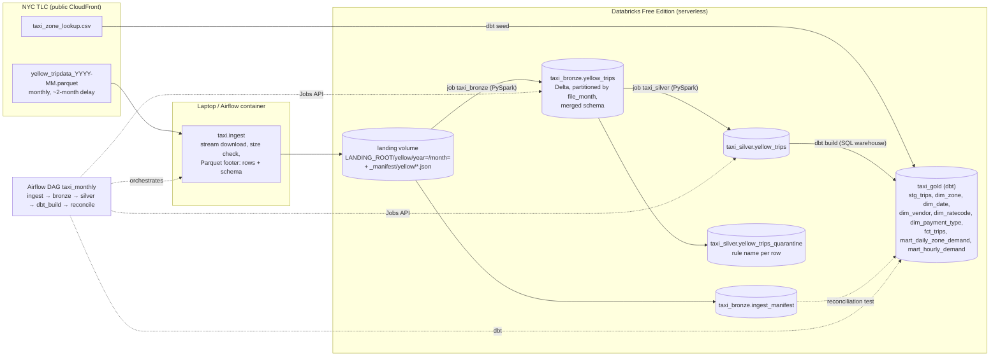

# Architecture

Per month, every row is accounted for: Parquet footer rows (manifest) = bronze rows = silver rows + quarantined rows, and fact rows = silver rows. The dbt test `reconcile_months` checks this for every loaded month.

The render check of this diagram and the others, at their current labels, is in `docs/evidence/mermaid-render-2026-11-17.txt`.
